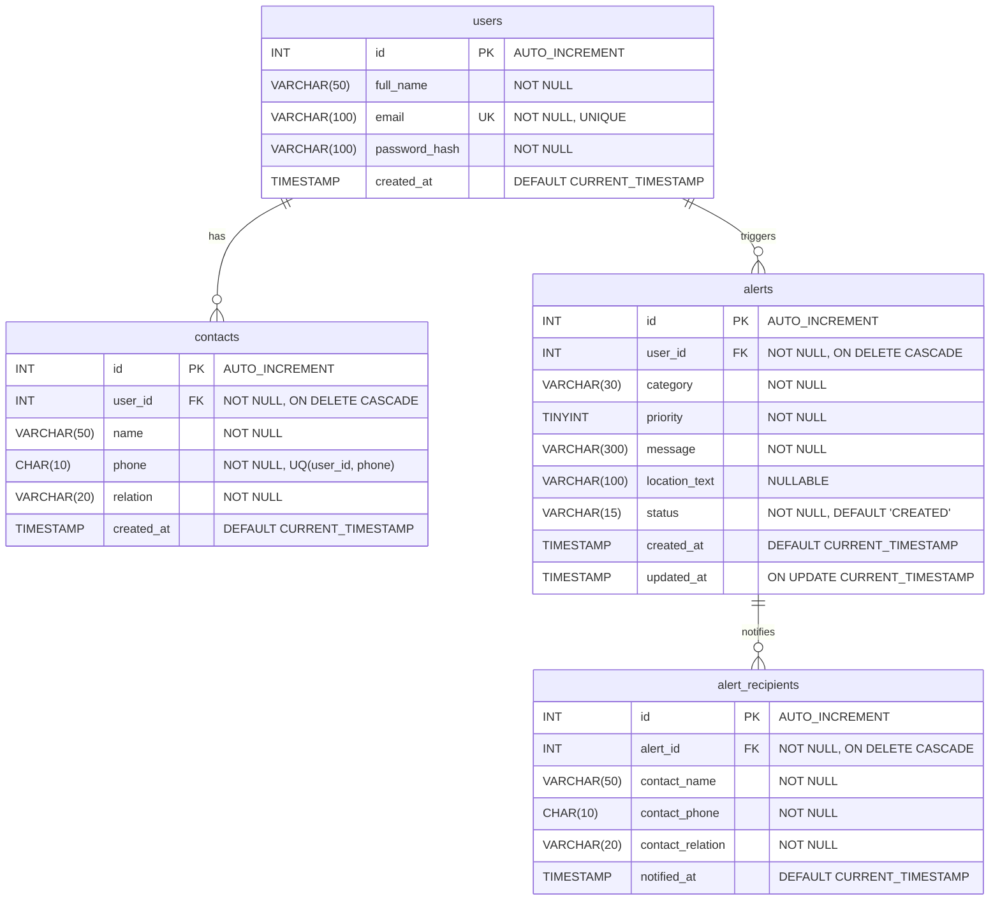
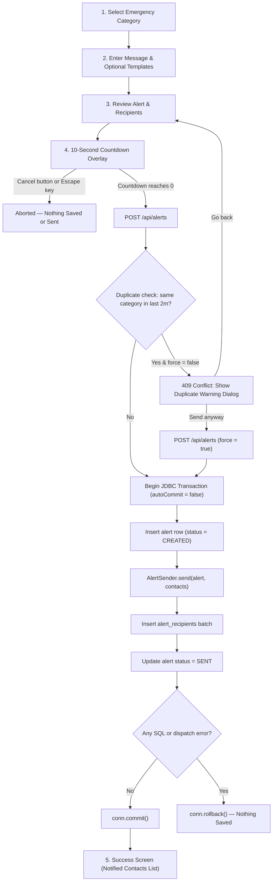

# Beacon — Architecture & Flow Diagrams

This document illustrates Beacon's object-oriented class design, relational database schema, and end-to-end SOS dispatch flow.

## 1. Class Diagram

```mermaid
classDiagram
    class BaseEntity {
        <<abstract>>
        -Integer id
        -Instant createdAt
        +getId() Integer
        +setId(Integer) void
        +getCreatedAt() Instant
        +setCreatedAt(Instant) void
    }

    class User {
        -String fullName
        -String email
        -String passwordHash
    }

    class EmergencyContact {
        -int userId
        -String name
        -String phone
        -Relation relation
    }

    class Alert {
        -int userId
        -EmergencyCategory category
        -int priority
        -String message
        -String locationText
        -AlertStatus status
        -Instant updatedAt
        -List~AlertRecipient~ recipients
    }

    class AlertRecipient {
        -Integer id
        -int alertId
        -String contactName
        -String contactPhone
        -Relation contactRelation
        -Instant notifiedAt
    }

    class EmergencyCategory {
        <<enumeration>>
        MEDICAL(1)
        FIRE(1)
        ACCIDENT(2)
        HARASSMENT(2)
        NATURAL_DISASTER(2)
        THEFT(3)
        OTHER(4)
        +getPriority() int
        +getLabel() String
    }

    class AlertStatus {
        <<enumeration>>
        CREATED
        SENT
        RESOLVED
        CANCELLED
        +canChangeTo(AlertStatus next) boolean
    }

    class Relation {
        <<enumeration>>
        PARENT
        SIBLING
        FRIEND
        NEIGHBOR
        DOCTOR
        OTHER
        +getLabel() String
    }

    class AlertSender {
        <<interface>>
        +send(Alert alert, List~EmergencyContact~ contacts) List~AlertRecipient~
    }

    class SimulatedAlertSender {
        +send(Alert alert, List~EmergencyContact~ contacts) List~AlertRecipient~
    }

    class LoggingAlertSender {
        -AlertSender delegate
        +send(Alert alert, List~EmergencyContact~ contacts) List~AlertRecipient~
    }

    class UserDao {
        <<interface>>
        +findByEmail(String email) Optional~User~
        +findById(int id) Optional~User~
        +create(User user) User
    }

    class ContactDao {
        <<interface>>
        +findAllByUserId(int userId) List~EmergencyContact~
        +findByIdAndUserId(int id, int userId) Optional~EmergencyContact~
        +create(EmergencyContact contact) EmergencyContact
        +update(EmergencyContact contact) EmergencyContact
        +deleteByIdAndUserId(int id, int userId) boolean
    }

    class AlertDao {
        <<interface>>
        +insert(Connection conn, Alert alert) Alert
        +insertRecipients(Connection conn, int alertId, List~AlertRecipient~ recipients) void
        +updateStatus(Connection conn, int alertId, int userId, AlertStatus status) void
        +findLatestByUserIdAndCategory(int userId, EmergencyCategory category) Optional~Alert~
        +findByIdAndUserId(int id, int userId) Optional~Alert~
        +findAllByUserId(int userId) List~Alert~
    }

    class AuthService {
        -UserDao userDao
        -PasswordHasher passwordHasher
        +register(RegisterRequest) UserResponse
        +login(LoginRequest) UserResponse
        +getCurrentUser(int userId) UserResponse
    }

    class ContactService {
        -ContactDao contactDao
        +listContacts(int userId, String query) List~ContactResponse~
        +createContact(int userId, ContactRequest) ContactResponse
        +updateContact(int userId, int contactId, ContactRequest) ContactResponse
        +deleteContact(int userId, int contactId) void
    }

    class AlertService {
        -AlertDao alertDao
        -ContactDao contactDao
        -AlertSender alertSender
        -DatabaseConnection databaseConnection
        +createAlert(int userId, CreateAlertRequest) Alert
        +isRecentDuplicate(int userId, EmergencyCategory, Instant) boolean
        +listAlerts(...) PagedAlertsResponse
        +getAlert(int userId, int alertId) AlertResponse
        +updateStatus(int userId, int alertId, AlertStatus) AlertResponse
    }

    class StatsService {
        -AlertDao alertDao
        -ContactDao contactDao
        +getSummary(int userId) StatsSummaryResponse
    }

    class AlertByNewestFirst {
        +compare(Alert a, Alert b) int
    }

    class AlertByOldestFirst {
        +compare(Alert a, Alert b) int
    }

    class AlertByPriority {
        +compare(Alert a, Alert b) int
    }

    BaseEntity <|-- User
    BaseEntity <|-- EmergencyContact
    BaseEntity <|-- Alert

    Alert "1" *-- "many" AlertRecipient
    EmergencyContact --> Relation
    Alert --> EmergencyCategory
    Alert --> AlertStatus
    AlertRecipient --> Relation

    AlertSender <|.. SimulatedAlertSender
    AlertSender <|.. LoggingAlertSender
    LoggingAlertSender o-- AlertSender : delegates

    AuthService --> UserDao
    ContactService --> ContactDao
    AlertService --> AlertDao
    AlertService --> ContactDao
    AlertService --> AlertSender
    StatsService --> AlertDao
    StatsService --> ContactDao

    AlertService ..> AlertByNewestFirst : uses
    AlertService ..> AlertByOldestFirst : uses
    AlertService ..> AlertByPriority : uses
    StatsService ..> AlertByNewestFirst : uses
```

## 2. Entity-Relationship (ER) Diagram

## 3. SOS Dispatch Flow Diagram

